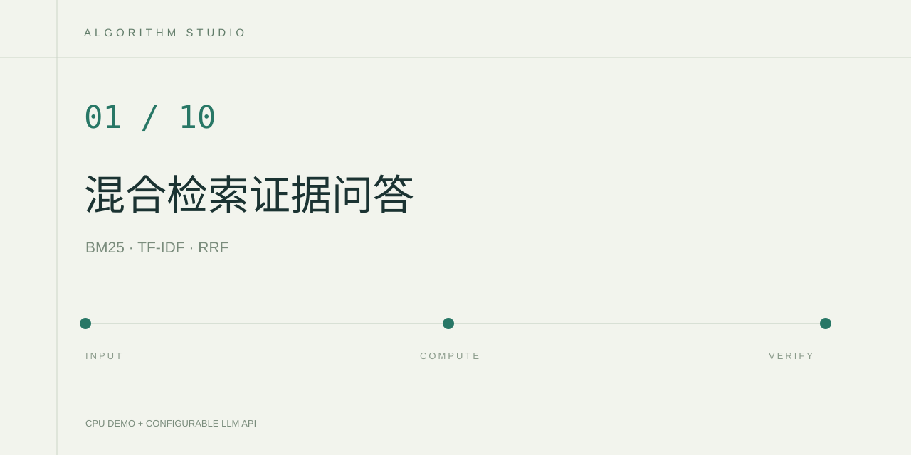

# Hybrid Evidence RAG

一个运行在 CPU 上的混合检索问答实验。输入工业资料问题，查看 BM25、字符 TF-IDF 与 RRF 融合后的排序，以及生成回答所使用的原文。

## 实现内容

- 自行实现 BM25 词频与逆文档频率评分。
- 使用中文字符 2～4 gram TF-IDF，避免依赖外部分词服务。
- 以 Reciprocal Rank Fusion 融合两个排序，并显示各自分数。
- 未检索到证据时直接返回证据不足。
- 本地模式提供证据摘录，API 模式根据相同证据生成带引用的回答。

`data/documents.json` 全部是本项目编写的合成教学资料，设备和维护场景均为演练。文档量很小，当前实现用于理解检索与证据约束。

## 在 PyCharm 运行

使用 Python 3.12 打开当前项目目录，安装 `requirements.txt`，运行 `app.py`，打开运行窗口中的本地地址。第一次可选择本地演示。API 模式按 `.env.example` 在运行配置中设置环境变量，密钥只留在本机。

## 验证算法

在项目目录运行 `python -m unittest discover -s tests`。测试验证设备查询的排序、未知问题拒答、空问题处理和 RRF 排序融合。

进一步评估时，应先人工编写问题与相关文档 ID，再比较 BM25、TF-IDF 和融合方案的 Recall@k、MRR。记录真实运行结果，分开标注本地摘录和 API 生成回答。当前阈值只对小型演示语料做启发式过滤，不能证明开放问题的拒答可靠性。API 引用仍应人工核验。

## 参考

- [RRF 原始论文](https://cormack.uwaterloo.ca/cormacksigir09-rrf.pdf)
- [scikit-learn TfidfVectorizer](https://scikit-learn.org/stable/modules/generated/sklearn.feature_extraction.text.TfidfVectorizer.html)
- [DeepSeek Tool Calls 与 API 文档](https://api-docs.deepseek.com/guides/tool_calls/)
